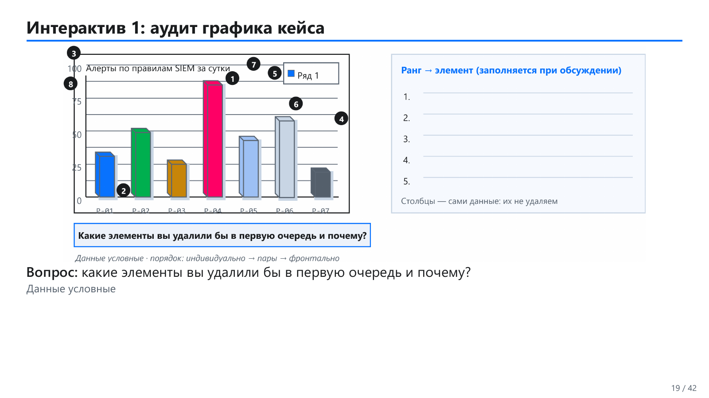
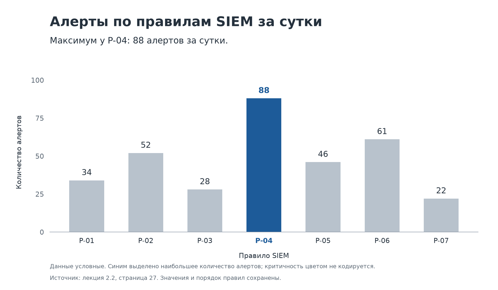

# Дизайн визуализаций: квартет Энскомба и очистка графика

Курс «Интеллектуальный анализ данных и визуализация», лекция 2.2. Задания к 10 октября 2026 года.

## Задание 1. Что показывает квартет Энскомба

1. **Совпадение сводных статистик не означает одинаковую структуру данных.** В четырёх наборах квартета Энскомба одинаковое число наблюдений, а средние, дисперсии, корреляции и уравнения линейной регрессии практически совпадают при приведённой точности. Однако диаграммы рассеяния показывают разные структуры: облако с приблизительно линейной зависимостью, криволинейную зависимость, почти прямую линию с выбросом и вертикальную группу с одной удалённой точкой.

2. **Корреляция и линия регрессии могут скрывать особенности зависимости.** Для первого набора линейная модель описывает общую тенденцию, для второго она не отражает форму кривой. В третьем и четвёртом наборах отдельные необычные наблюдения сильно влияют на результат. Поэтому похожие статистики не доказывают, что всем наборам подходит одна модель и одна интерпретация.

3. **Численные характеристики нужно дополнять визуализацией и контекстом.** Диаграмма рассеяния позволяет увидеть кривизну, выбросы и расположение точек, которые не сохраняются в среднем значении или коэффициенте корреляции. В анализе SOC одинаковое среднее число алертов за сутки может соответствовать как равномерной активности, так и краткому всплеску. Перед выводом следует проверить распределение и структуру данных, важные для конкретного вопроса.

Источник: [презентация лекции 2.2](<../../materials/2.2_Л_Дизайн/2.2_Л_Дизайн_Презентация.pdf>), страницы PDF 31–36; формулировка задания — страница 40.

## Задание 2. Очистка графика

### Цель и исходные данные

Вопрос графика: **какое правило SIEM сформировало больше всего алертов за сутки и как соотносятся показатели семи правил?** Изображается количество алертов по правилам. По этому графику нельзя определить критичность алертов или число подтверждённых инцидентов.

Использован разрешённый учебный макет «Алерты по правилам SIEM за сутки». Данные условные, взяты из лекции, а не рассчитаны по набору SOC. Точные значения подписаны в примере преподавателя на странице PDF 27; они не оценивались по высоте объёмных столбцов.

| Правило | Количество алертов за сутки |
|---|---:|
| P-01 | 34 |
| P-02 | 52 |
| P-03 | 28 |
| P-04 | 88 |
| P-05 | 46 |
| P-06 | 61 |
| P-07 | 22 |

Все значения и порядок правил сохранены. Синий акцент в итоговом графике обозначает только максимальное количество алертов; он не кодирует критичность.

### До очистки

Исходный слайд со страницы PDF 19 сохранён без изменений. Нумерованные отметки и панель справа относятся к обсуждению графика на занятии. Пример преподавателя со страницы 27 использован для проверки значений; итоговый график построен отдельно по этим данным.

### Шаг 1. Инвентаризация элементов

На графике присутствуют столбцы, подписи правил, числовая шкала, заголовок, тёмная внешняя рамка, многочисленные горизонтальные линии сетки, объёмные грани, смещённые тени, разноцветные заливки, легенда «Ряд 1» и нумерованные отметки. Вокруг графика находятся учебные вопросы и панель обсуждения.

### Шаг 2. Классификация элементов

| Категория | Элементы | Решение |
|---|---|---|
| Данные | Высота столбцов, подписи правил, числовая шкала | Сохранить значения, категории, общую шкалу и нулевую базовую линию |
| Полезный контекст | Заголовок, единицы измерения, указание на условность данных | Сохранить или указать явно |
| Декор и избыточность | Объёмные грани, тени, внешняя рамка, формальная легенда, произвольная разноцветность | Удалить или заменить более простым представлением |
| Спорные элементы | Сетка, цветовой акцент, учебные отметки | Оставлять только при пользе для конкретной задачи чтения графика |

### Шаги 3–6. Семь изменений и их обоснование

| № | Удалённый или заменённый элемент | Обоснование и замена |
|---|---|---|
| 1 | Объёмные грани и эффект 3D | Дополнительные грани не представляют переменную и усложняют сравнение границ столбцов. Заменены плоскими столбцами с общей нулевой базовой линией. |
| 2 | Смещённые тени за столбцами | Тени повторяют формы, но не добавляют данных. Удалены, чтобы на графике оставались только семь столбцов с показателями. |
| 3 | Тёмная внешняя рамка | Рамка не кодирует значение и не разделяет функциональные панели. Удалена; сохранена лёгкая базовая линия. |
| 4 | Многочисленные контрастные линии сетки | Точные значения теперь подписаны над столбцами; числовая шкала остаётся. Сетка удалена, чтобы не конкурировать с данными. |
| 5 | Легенда «Ряд 1» | Для единственного показателя эта подпись не объясняет дополнительную группировку. Легенда удалена; показатель назван в заголовке и на оси, значения подписаны напрямую. |
| 6 | Произвольные разные цвета правил | Соответствие цветов критичности или другим признакам не задано. Использованы нейтральные столбцы и один синий акцент для максимума. Максимум также обозначен высотой, числом и текстом. |
| 7 | Нумерованные учебные отметки | Номера относятся к аудиту на занятии, а не к правилам, значениям или статусам. В самостоятельном аналитическом графике они удалены; исходный слайд сохранён для сравнения. |

### После очистки

Сохранены тема заголовка, период «за сутки», все значения и идентификаторы правил. Вертикальная ось подписана «Количество алертов», шкала начинается с нуля. Порядок категорий оставлен исходным, чтобы сравнение до и после отражало очистку оформления.

### Условия для спорных решений

- **Сетка.** Если убрать числовые подписи, редкие бледные линии могут помогать оценивать значения. Здесь числа читаются напрямую, поэтому сетка удалена. При большом количестве столбцов и перекрывающихся подписях решение следует пересмотреть.
- **Легенда.** При нескольких содержательных рядах нужна легенда рядом с данными, если прямые подписи перекрываются. Для одного показателя легенда «Ряд 1» не даёт полезного соответствия.
- **Заголовок и единицы.** Их необходимо сохранить: они объясняют, что считается, за какой период и в каких единицах.
- **Цвет.** Если цвет кодирует критичность или статус, нужно сохранить согласованную палитру. В данном макете акцент означает только наибольшее количество; его смысл указан в примечании.
- **Рамка.** Лёгкая граница может разделять панели дашборда. Для отдельного графика тёмная замкнутая рамка не требуется.
- **Порядок категорий.** Сортировка полезна для ранжирования, но в сравнении до и после сохранение порядка упрощает проверку. Для будущего дашборда порядок следует выбирать по аналитической задаче.

### Качественная оценка и проверка чтения

Неданных элементов стало меньше: объёмные грани, тени, рамка, контрастная сетка, формальная легенда и учебные отметки больше не отвлекают от столбцов. При этом добавлены точные числовые подписи, поскольку они помогают чтению. Заголовок, шкала, единицы и указание на источник сохранены как необходимый контекст.

Основной вывод: **P-04 сформировало больше всего алертов — 88 за сутки**. Далее следует P-06 с 61 алертом; минимум у P-07 — 22. Максимум обозначен цветом, подписью и текстовым выводом, поэтому его можно определить без обращения к легенде. Общая шкала и нулевая базовая линия сохраняют корректное сравнение величин.

Ориентир чек-листа — распознать основной сигнал примерно за 3–5 секунд. В этом графике для такой проверки достаточно найти выделенное правило и прочитать его число, затем убедиться, что понятны показатель и период. Оценка уменьшения визуального шума качественная; время чтения в эксперименте не измерялось.

## Источники

- [Презентация лекции 2.2 «Дизайн»](<../../materials/2.2_Л_Дизайн/2.2_Л_Дизайн_Презентация.pdf>): страница PDF 19 — исходный макет; 27 — точные значения; 31–36 — квартет Энскомба; 40 — задания.
- [Опорный конспект лекции 2.2](<../../materials/2.2_Л_Дизайн/2.2_Л_Дизайн_Опорный_конспект_v01.docx>): раздел 8 — задания и критерии готовности.
- [Чек-лист очистки графика](<../../materials/2.2_Л_Дизайн/2.2 Чек-лист очистки графика.docx>): порядок очистки, условия для спорных элементов и требования к сравнению до и после.
