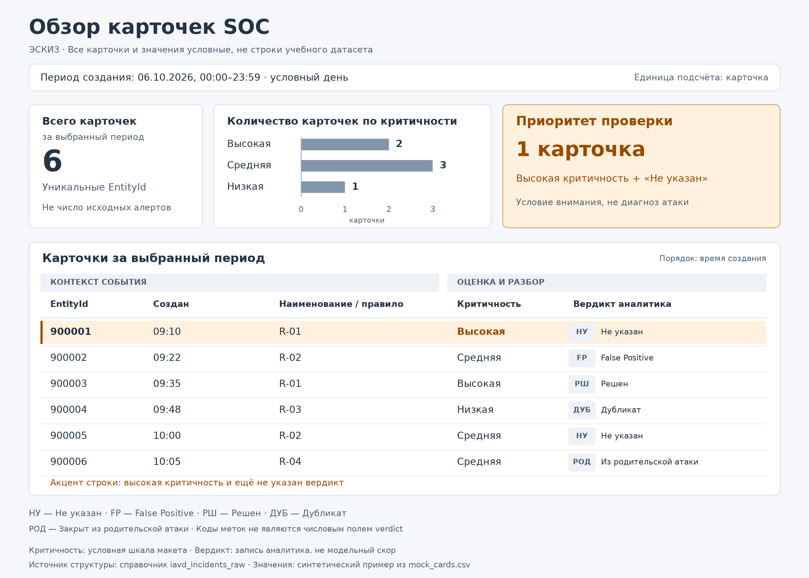

# Восприятие и эскиз обзора карточек SOC

Курс «Интеллектуальный анализ данных и визуализация», лекция 2.1. Предметная область: SOC/SOAR. Основание — [проекция DIKW](../dikw_soc/DIKW_SOC.md).

## Аналитическая задача

Обзор должен помочь аналитику оценить количество карточек за выбранный период, сопоставить их критичность и результат разбора, а затем найти карточку, которую следует проверить. Это поддерживает переход от информации к решению: сначала видны объём и контекст потока, затем аналитик проверяет основания конкретного случая. Эскиз показывает устройство обзора; это не готовое приложение и не результат анализа реального набора.

## Пять ключевых полей

| Поле из структуры `iavd_incidents_raw` | Назначение в обзоре | Представление |
|---|---|---|
| `EntityId` | Различить карточки и задать единицу подсчёта | Идентификатор в строке; количество уникальных карточек в сводке |
| `Создан` | Определить период и временной контекст | Период над обзором; время создания рядом с идентификатором |
| `Наименование` | Показать правило корреляции и сопоставить связанные срабатывания | Текстовая колонка в группе «Контекст события» |
| `Критичность` | Сопоставить уровни и задать условие приоритетного внимания | Упорядоченные категории, подписи и умеренный акцент |
| `Вердикт` | Показать зафиксированный аналитиком исход разбора | Текстовая метка с кодом, отделённая от критичности |

**Количество карточек — вычисляемый показатель, а не шестое исходное поле:** `COUNT(DISTINCT EntityId)` после фильтра по `Создан`. Одна строка набора — карточка, которая может объединять несколько алертов; число исходных алертов этим подсчётом не определяется. Перед расчётом на реальных данных нужно проверить пропуски идентификатора, повторы и временную зону.

## Обоснование кодировок — семь предложений

1. Количество карточек по критичности представлено длиной горизонтальных столбцов от общей нулевой линии и точными подписями, поскольку положение и длина на общей шкале подходят для сравнения величин лучше, чем площадь или угол.
2. Критичность показана словами и упорядоченными категориями, чтобы её порядок можно было прочитать без догадки по цвету.
3. Тёплый акцент зарезервирован для сочетания высокой критичности и вердикта «Не указан», поэтому он направляет внимание на необходимость проверки, а не автоматически объявляет карточку атакой.
4. Вердикт закодирован нейтральной текстовой меткой с коротким кодом, что отделяет результат разбора от критичности и не требует различать только красный и зелёный цвета.
5. Идентификатор, время и правило расположены рядом в группе «Контекст события», а критичность и вердикт — в группе «Оценка и разбор», чтобы связанные сведения сопоставлялись без переходов между удалёнными частями экрана.
6. Общие заголовки, выравнивание колонок и небольшие интервалы внутри групп используют близость и сходство для организации обзора.
7. Выделение продублировано подписью «Приоритет проверки» и описанным условием, поэтому основной сигнал не зависит только от цвета и не подменяется модельным скором.

## Эскиз

[Векторная версия эскиза](sketch.svg).

Все шесть карточек в эскизе **условные и созданы для демонстрации**, а не извлечены из датасета. Идентификаторы, время и правила вымышлены; категории критичности «Высокая», «Средняя», «Низкая» составляют условную шкалу макета. При реализации нужно сопоставить её с фактическими значениями внутреннего справочника, отдельно отображая неизвестные и пустые категории.

### Что выделяется преаттентивно

Верхнее сообщение «Приоритет проверки» и первая строка имеют общий тёплый акцент: у этой условной карточки высокая критичность и ещё не указан вердикт. Вторую карточку высокой критичности с вердиктом «Решен» макет не выделяет тем же способом. Так акцент обозначает конкретное условие внимания, а не все значения высокой критичности подряд. Отсутствие акцента не означает, что расследование не нужно: окончательное решение требует контекста и принятого процесса SOC.

### Как группируются элементы

Верхний блок содержит период, общий объём и распределение карточек по критичности. Нижний блок предназначен для сопоставления отдельных карточек; его колонки объединены общими заголовками «Контекст события» и «Оценка и разбор». Правило, идентификатор и время остаются в одной строке, поэтому сводка не заменяет контекст отдельного случая.

### Чем кодируется вердикт

Использованы значения из справочника: «Не указан», `False Positive`, «Решен», «Дубликат», «Закрыт из родительской атаки». Для компактности в последнем случае в строке написано «Из родительской атаки», а полное значение приведено в легенде. Коды `НУ`, `FP`, `РШ`, `ДУБ`, `РОД` — только элементы оформления, не значения числового поля `verdict`. Все метки имеют нейтральное оформление: «Решен» не окрашен как доказательство безопасной активности, а `False Positive` показан как записанный вердикт, а не вычисленный исход классификатора.

## Проверка согласованности

- Всего в условном примере 6 уникальных карточек: высокой критичности — 2, средней — 3, низкой — 1; сумма групп равна общему количеству.
- Вердикт «Не указан» есть у 2 карточек; сочетанию высокой критичности и этого вердикта соответствует 1 карточка.
- Выбранные пять исходных полей видны в таблице; количество карточек получено агрегацией идентификаторов.
- Преаттентивный акцент, группировка и кодировка вердикта различимы; смысл акцента указан текстом.
- Модельный скор не используется вместо вердикта; условные карточки явно обозначены.

Эскиз не является измерением скорости поиска и не доказывает снижение FP/FN. Он задаёт проверяемый вариант организации внимания и контекста для дальнейшей реализации.

## Источники

- [Презентация лекции 2.1](<../../materials/2.1_Л_Восприятие/2.1_Л_Восприятие_Презентация.pdf>): слайды 40–41 — задание и критерии; темы внимания, группировки и визуальных кодировок.
- [Опорный конспект лекции 2.1](<../../materials/2.1_Л_Восприятие/2.1_Л_Восприятие_Опорный_конспект.docx>): разделы 3 и 8 — принципы обзора и требования к эскизу.
- [Справочник полей](<../../materials/00_Общее/iavd_incidents_raw_field_dictionary.md>): определения `EntityId`, `Создан`, `Наименование`, `Критичность`, `Вердикт` и единицы наблюдения.

Связанное обязательное чтение: глава 4 «Направьте внимание аудитории» книги Коул Нассбаумер Нафлик «Данные: визуализируй, расскажи, используй».
